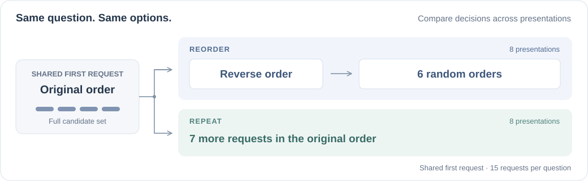

<h1 align="center">Understanding Jev-Style System One Models:<br>Does Structure Reduce Selection Bias?</h1>

<p align="center">
  Mingyang Song · Mao Zheng · Zhiyuan Ma · Xinpeng Zhou<br>
  <b>Tencent</b>
</p>

<p align="center">
  <a href="https://arxiv.org/abs/2610.35826"></a>
  <a href="#quick-start"></a>
  <a href="#evaluation-data"></a>
  <a href="CITATION.cff"></a>
</p>

<p align="center">
  <a href="https://arxiv.org/abs/2610.35826">Paper</a> ·
  <a href="#quick-start">Quick start</a> ·
  <a href="#evaluation-data">Data</a> ·
  <a href="#supported-models">Models</a> ·
  <a href="#evaluation-protocol">Protocol</a> ·
  <a href="#citation">Citation</a>
</p>

**A simple test: keep the question and options fixed, change their order.**
Does Jev-style structure make choices less sensitive to how the options are
presented? We compare reordered options with repeated requests in the original
order, tracking both accuracy and the stability of individual decisions.

<p align="center">
  
</p>

This repository accompanies the [paper](https://arxiv.org/abs/2610.35826) with **evaluation code and input manifests**:
exact question selections and permutations, scripts to reconstruct benchmark
inputs, and a shared runner and scorer for HTTP APIs and native decision models.

## Quick start

### 1. Install

Use **Python 3.10+** for HTTP evaluation. Native models have a separate
[setup guide](docs/NATIVE_MODELS.md). Run the commands below from the repository root.

```bash
git clone https://github.com/nick7nlp/Jev-Selection-Bias.git
cd Jev-Selection-Bias
python3 -m venv .venv
source .venv/bin/activate
python3 -m pip install -e '.[data]'
```

### 2. Prepare the questions

Reconstruct the primary collection of **1,700 questions** from SuperGPQA and LEXam:

```bash
python3 scripts/prepare_questions.py \
  --datasets supergpqa lexam \
  --output data/questions.jsonl
```

This downloads the pinned sources and verifies the reconstructed inputs.
For MMLU-Pro and GPQA Diamond, see [additional datasets](#additional-datasets).

<details>
<summary><b>Preview the requests without calling a model</b></summary>

This creates the 75 requests for five questions without credentials or inference:

```bash
python3 -m jev_eval run \
  --questions data/questions.jsonl \
  --datasets supergpqa lexam --limit 5 \
  --config configs/jev.example.json \
  --output runs/requests.jsonl --dry-run
```

</details>

### 3. Configure a model

For a Jev endpoint:

```bash
cp configs/jev.example.json configs/model.local.json
export JEV_ENDPOINT="https://YOUR_HOST/YOUR_COMPLETE_ENDPOINT_PATH"
export JEV_API_KEY="YOUR_API_KEY"
```

Replace the placeholders with your provider's endpoint and key, and edit `model`
in `configs/model.local.json` to the model ID accepted by that endpoint. The
endpoint must be the **complete request URL**, including its path. For other
interfaces, choose the matching [configuration below](#supported-models).

### 4. Evaluate and score

Start with five questions (**75 requests** across both sequences):

```bash
python3 -m jev_eval run \
  --questions data/questions.jsonl \
  --datasets supergpqa lexam --limit 5 \
  --config configs/model.local.json \
  --output runs/trial-selections.jsonl

python3 -m jev_eval score \
  --questions data/questions.jsonl \
  --datasets supergpqa lexam --limit 5 \
  --predictions runs/trial-selections.jsonl \
  --output runs/trial-metrics.json
```

Remove `--limit 5` from **both** commands for the full primary collection, and choose
new output paths. Existing outputs are never overwritten. Use matching
`--datasets`, `--limit`, and `--protocol` settings when running and scoring.

## Evaluation data

| Benchmark | Questions | Options per question |
| --- | ---: | --- |
| [SuperGPQA](https://huggingface.co/datasets/m-a-p/SuperGPQA) | 1,200 | 10 |
| [LEXam](https://huggingface.co/datasets/LEXam-Benchmark/LEXam) | 500 | 4, 8, 16, or 32 |
| [MMLU-Pro](https://huggingface.co/datasets/TIGER-Lab/MMLU-Pro) | 300 | 8, 9, or 10 |
| [GPQA Diamond](https://github.com/idavidrein/gpqa) | 198 | 4 |

SuperGPQA and LEXam form the primary collection of **1,700 questions**.
MMLU-Pro and GPQA Diamond provide complementary evaluations, for **2,198
questions** across all four datasets.

[`data/cases.jsonl`](data/cases.jsonl) specifies the exact selected questions, source identifiers,
answer indices, metadata, and input fingerprints. [`data/permutations.jsonl`](data/permutations.jsonl)
contains every candidate permutation used by the test. Question and option text
are reconstructed from the upstream datasets; see
[data sources and attribution](docs/DATA_SOURCES.md).

<a id="additional-datasets"></a>

<details>
<summary><b>Prepare MMLU-Pro and GPQA Diamond</b></summary>

To prepare all four datasets, obtain the official GPQA Diamond CSV following
[DATA_SOURCES.md](docs/DATA_SOURCES.md), then run:

```bash
python3 scripts/prepare_questions.py \
  --gpqa-csv /path/to/gpqa_diamond.csv \
  --output data/questions-all.jsonl
```

Use `--questions data/questions-all.jsonl` for evaluation and scoring. Omit
`--datasets` to include all four benchmarks, or select any subset. To prepare
MMLU-Pro without GPQA, use `--datasets supergpqa lexam mmlu_pro`; this does not
require a GPQA CSV. See the data guide for offline reconstruction and attribution.

</details>

## Supported models

| Interface | Configuration | Environment variables |
| --- | --- | --- |
| Jev | [Jev example](configs/jev.example.json) | `JEV_ENDPOINT`, `JEV_API_KEY` |
| Chat Completions | [Chat example](configs/chat.example.json) | `CHAT_ENDPOINT`, `CHAT_API_KEY` |
| Responses | [Responses example](configs/responses.example.json) | `RESPONSES_ENDPOINT`, `RESPONSES_API_KEY` |
| Anthropic Messages | [Messages example](configs/anthropic.example.json) | `ANTHROPIC_ENDPOINT`, `ANTHROPIC_API_KEY` |
| Native decision head | [Native example](configs/native.example.json) | `MODEL_PATH` |

For **AutoTrust, StartLux, and other Jev reproductions**, follow the
[native model guide](docs/NATIVE_MODELS.md) for model sources, dependencies, and
backend selection. Set `MODEL_PATH` to a local model directory. Native evaluation
uses the model's task format and decision head, with one worker.

<details>
<summary><b>Configuration and run options</b></summary>

Copy the matching example to a `*.local.json` file. Set `model` and use only
`parameters` supported by your provider. If the API returns a different model
name, such as a dated snapshot, add `accepted_model_names` with the expected
response names. Credentials stay in environment variables; local configurations,
downloaded data, and run outputs are ignored by Git.

Both commands default to the complete protocol. `--protocol orders` selects the
eight reordered presentations; `--protocol repeats` selects eight original-order
presentations. `--workers` controls HTTP concurrency and defaults to one.
`--limit N` selects the first N questions in manifest order after dataset filtering.

</details>

## Evaluation protocol

Each question has **two sequences of eight presentations**:

- **Reordered:** the original order, the reverse order, and six recorded random
  permutations.
- **Repeated:** eight presentations of the original order.

The sequences share their first presentation, giving **15 requests per
question**. Every presentation uses the complete candidate set. The code maps
returned keys to stable candidate identities before scoring.

Moving a candidate to a different position does not itself count as changing
the decision.

<details>
<summary><b>What the scorer measures</b></summary>

- **Accuracy:** fraction of questions answered correctly at each presentation.
- **Cumulative failed questions:** questions answered incorrectly at least once
  so far, counting each question once.
- **Distinct wrong candidates:** unique incorrect `(question, candidate)` pairs
  selected so far. This can exceed the question count if a model chooses multiple
  wrong options for the same question.
- **Cumulative candidate agreement:** fraction of questions receiving the same
  candidate selection throughout the sequence so far.
- **Retention of initial successes:** fraction of initially correct questions
  answered correctly throughout the sequence so far.

</details>

<details>
<summary><b>Run the tests</b></summary>

```bash
python3 -m unittest discover -s tests -v
```

The tests use synthetic questions and local mock HTTP servers. They do not call
model providers.

</details>

## Citation

If you use this code or the evaluation manifests, please cite our paper:

```bibtex
@misc{song2026understandingjevstylemodelsdoes,
  title = {Understanding Jev-Style System One Models: Does Structure Reduce Selection Bias?},
  author = {Mingyang Song and Mao Zheng and Zhiyuan Ma and Xinpeng Zhou},
  year = {2026},
  eprint = {2610.35826},
  archivePrefix = {arXiv},
  primaryClass = {cs.CL},
  url = {https://arxiv.org/abs/2610.35826}
}
```

The citation is also available in [CITATION.cff](CITATION.cff) and
[references.bib](references.bib). Please also cite the benchmarks you use;
their paper links and BibTeX entries are listed in
[data sources and attribution](docs/DATA_SOURCES.md#benchmark-papers).

## Acknowledgments

This evaluation builds on SuperGPQA, LEXam, MMLU-Pro, and GPQA, and on the native
interfaces provided by the decision-model authors. Dataset attribution and
licenses are documented in [dataset notices](third_party/DATA_NOTICES.md);
attribution for adapted code appears in [code notices](third_party/CODE_NOTICES.md).
Model weights are obtained separately from the sources linked in the
[native model guide](docs/NATIVE_MODELS.md).
